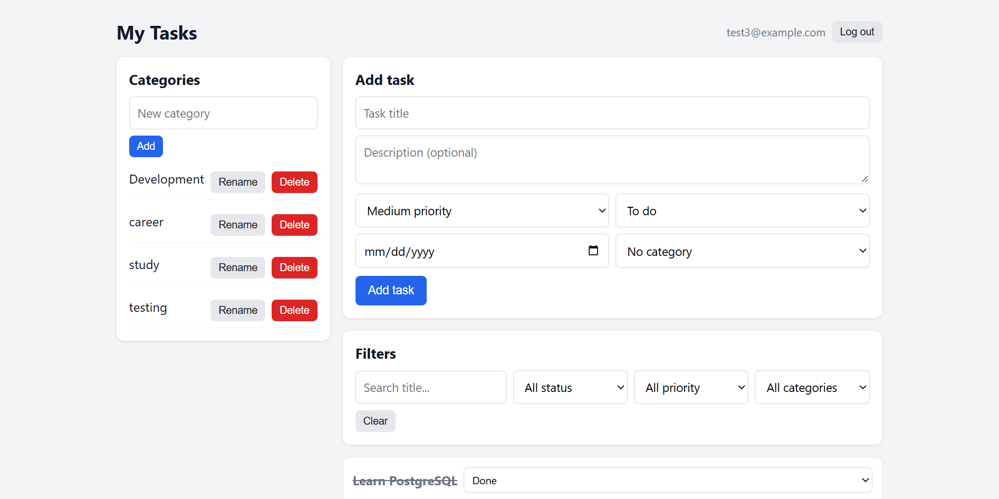
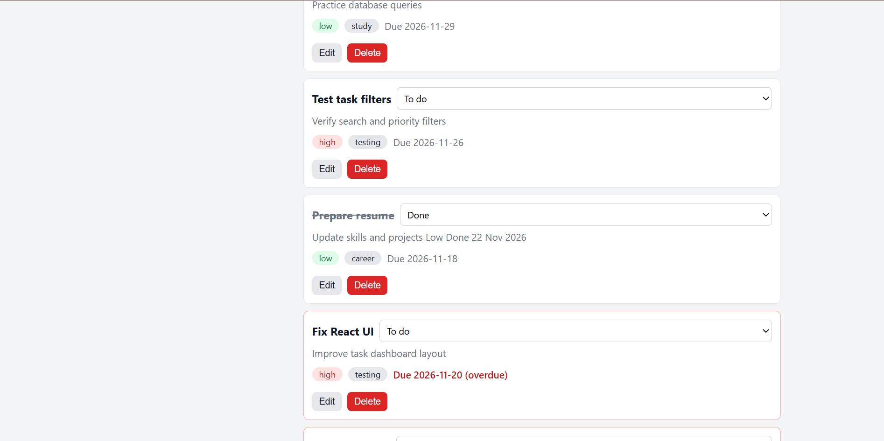
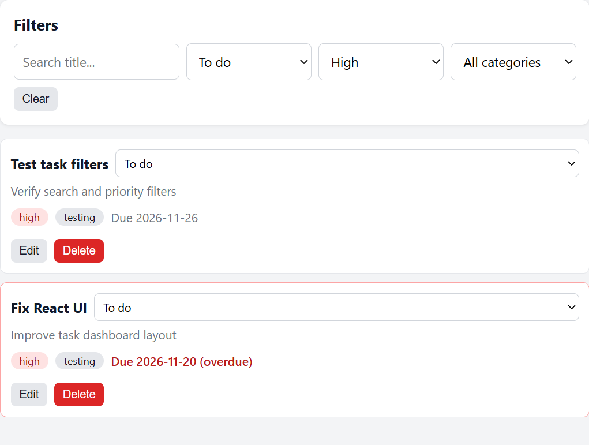

# Multi-User Task Manager


## Screenshots





A full-stack task app where each user registers, logs in, and manages only their own tasks.

**Live demo:** https://task-manager-frontend-b869.onrender.com
(Hosted on free plans. The first load can take about a minute while the server wakes up.)

## Features

- Register and log in with JWT authentication; passwords hashed with bcrypt
- Create, read, update and delete tasks (title, description, status, priority, due date)
- Categories per user (create, rename, delete)
- Filter tasks by status, priority and category, and search by title
- Server-side validation on every input
- Each user can only see and change their own data

## Tech stack

| Layer | Tools |
|---|---|
| Frontend | React (Vite), React Router, Axios |
| Backend | Python, Flask, SQLAlchemy, Flask-Migrate, Flask-JWT-Extended, Marshmallow |
| Database | PostgreSQL (Neon) |
| Tests | pytest (50 tests), GitHub Actions |
| Hosting | Render (API and static site), Neon (database) |

## Database design

Three tables, linked with foreign keys:

- `users` (id, email unique, password_hash, created_at)
- `categories` (id, user_id, name), with a unique pair of (user_id, name)
- `tasks` (id, user_id, category_id, title, description, status, priority, due_date, timestamps)

Category names are stored once and referenced by tasks, so they are not repeated on every row. Deleting a user deletes their data. Deleting a category keeps its tasks.

## API

| Method | Endpoint | Description |
|---|---|---|
| POST | `/api/auth/register` | Create an account |
| POST | `/api/auth/login` | Get a JWT |
| GET | `/api/auth/me` | Current user |
| GET, POST | `/api/categories` | List and create categories |
| PUT, DELETE | `/api/categories/<id>` | Rename and delete a category |
| GET, POST | `/api/tasks` | List (with filters) and create tasks |
| GET, PUT, DELETE | `/api/tasks/<id>` | Read, update and delete a task |

Task filters: `?status=`, `?priority=`, `?category_id=`, `?q=` (title search).

## Security decisions

- Every query is filtered by the user id from the token. The server never trusts a user id sent by the client.
- Another user's task returns 404, not 403, so its existence is not revealed.
- Unknown fields in a request (such as `user_id`) are rejected.
- Wrong email and wrong password give the same error message.
- Tokens expire after 1 hour.
- Secrets live in environment variables and are not in the repo.

## Run locally (Windows PowerShell)

Needs Python 3.10+, Node 18+ and PostgreSQL.

```powershell
# 1. Databases
psql -U postgres -c "CREATE DATABASE taskdb;"
psql -U postgres -c "CREATE DATABASE taskdb_test;"

# 2. Backend
cd backend
python -m venv .venv
.\.venv\Scripts\Activate.ps1
pip install -r requirements.txt
copy .env.example .env      # then edit .env with your password and a secret key
flask --app app db upgrade
python app.py

# 3. Frontend (new terminal)
cd frontend
copy .env.example .env
npm install
npm run dev
```

Open http://localhost:5173

Generate a secret key with: `python -c "import secrets; print(secrets.token_hex(32))"`

## Run the tests

```powershell
cd backend
pytest -v
```

The tests use the separate `taskdb_test` database and refuse to run on any database whose name does not end in `_test`.

## Known limitations

- No pagination on the task list
- No rate limit on login attempts
- JWT is kept in localStorage (an HttpOnly cookie would be safer against XSS)
- No refresh tokens; users log in again after 1 hour
- No frontend tests
- Free hosting: the API sleeps after inactivity